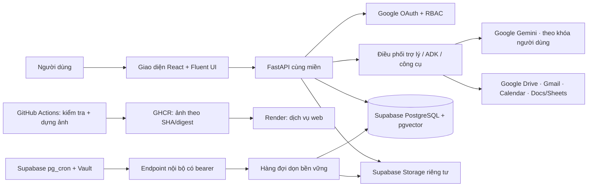

# Veridra — Bàn giao vận hành cho Google Antigravity

**Ngày chốt tài liệu:** 17/10/2026  
**Mục tiêu:** giúp người tiếp quản hiểu sản phẩm, chạy local, phát hành đúng ảnh, kiểm tra dữ liệu và tiếp tục đúng các việc còn thiếu mà không mở rộng phạm vi.

## 1. Sản phẩm và trạng thái phát hành

Veridra là trợ lý AI cho công việc nội bộ: tìm/đọc nguồn được cấp quyền, phân tích và đề xuất bước xử lý, chuẩn bị nội dung, rồi yêu cầu người dùng duyệt trước hành động ghi được phép. Bản hiện tại là closed beta giới hạn tối đa bốn tài khoản được mời; bằng chứng nghiệm thu chủ yếu từ tài khoản quản trị. Đây chưa phải không gian cộng tác toàn doanh nghiệp.

**Trạng thái tại lúc lập biên bản:**

- Thay đổi tự dọn dữ liệu Veridra sau 30 ngày đã được gộp vào main tại commit bd2ff8b4ed77d4193e08366f35d61d53c63ab1b6 (PR [#3](https://github.com/dbp3206-source/DriveAgent/pull/3)). CI PR #166 và CI main #167 đều đạt cả postgres-state và verify. Ảnh đã xuất bản: ghcr.io/dbp3206-source/veridra@sha256:bd55e7c9a176970947ea445af1e6a687233b9276d74ff2dc2d051bb1278326be.
- Render veridra-closed-beta vẫn dùng ảnh cũ sha256:7779331159a1ea652d2eed9ca7b11bdd70ca8018147536b8dd9253532436e448 ở lần đối chiếu gần nhất; bước triển khai tự động bị bỏ qua do RENDER_DEPLOY_HOOK chưa cấu hình. Chưa được coi mã lưu giữ mới đã chạy trên URL.
- Lịch tự dọn Supabase chưa được bật. Chính sách tự dọn chưa có hiệu lực cho tới khi ảnh mới Live, migration PostgreSQL được áp dụng và lịch Cron được xác nhận chạy.
- Không dùng nội dung riêng để gọi Gemini trong đợt này. Khóa Gemini hiện thuộc gói chưa bật thanh toán; không đưa thông tin cá nhân, nhạy cảm hoặc bí mật vào Gemini theo cấu hình này.
- Kết luận phát hành hiện tại: **closed beta/UAT có kiểm soát**, không chứng nhận production rộng. Còn thiếu xác minh ảnh mới + lịch lưu giữ, kiểm khôi phục DB/tệp (đã được chủ sở hữu cho phép bỏ qua trong đợt này), kiểm đủ bốn người dùng và bảo đảm vận hành cho dữ liệu có thông tin cá nhân.

## 2. Kiến trúc và luồng chính



Đường phát hành phải giữ nguyên thứ tự: **mã trên main → CI đủ hai job → ảnh container đúng commit → Render Live đúng digest → kiểm URL/health → bật lịch Supabase nếu được duyệt**. Không lấy trạng thái Live đơn lẻ làm bằng chứng ảnh đang chạy đúng mã.

## 3. Chạy local

Yêu cầu máy: Git, Python 3.11/3.12, Node.js 22.12 trở lên (hoặc bản 20 được nêu trong hướng dẫn). Dùng PowerShell:

```powershell
git clone https://github.com/dbp3206-source/DriveAgent.git
Set-Location DriveAgent
git switch main
powershell -ExecutionPolicy Bypass -File scripts/setup.ps1
```

Tạo .env từ .env.example; tự nhập khóa Gemini và cấu hình OAuth Google theo [SETUP_GOOGLE.md](SETUP_GOOGLE.md). Không gửi khóa, mật khẩu DB, OAuth JSON hoặc .env cho Antigravity/Chat và không commit chúng. Sau đó:

```powershell
.\backend\.venv\Scripts\python.exe scripts\local_config.py
powershell -ExecutionPolicy Bypass -File scripts\run-local.ps1
```

Mở http://localhost:8000. Dừng bằng Ctrl+C. Hướng dẫn chi tiết, OAuth scope, dữ liệu và lỗi thường gặp ở [START_LOCAL.md](START_LOCAL.md). Kiểm tra tự động đầy đủ bằng:

```powershell
powershell -ExecutionPolicy Bypass -File scripts/verify.ps1
```

Test tự động mặc định không gọi Gemini/Google thật; không dùng chúng để tuyên bố các luồng bên ngoài đã nghiệm thu.

## 4. Phát hành lên GitHub, GHCR và Render

1. Tạo nhánh riêng từ main, sửa có phạm vi, chạy scripts/verify.ps1; không sửa trực tiếp trên main.
2. Mở PR. Chỉ gộp khi postgres-state và verify của đúng commit đều xanh. verify gồm lint, backend, đánh giá ngoại tuyến, dữ liệu nghiệm thu, frontend, build và kiểm ảnh chạy/PDF tiếng Việt.
3. Gộp vào main; workflow tạo ảnh GHCR theo commit SHA, ghi digest image@sha256:... vào artifact veridra-image-<sha>.
4. Nếu bước Deploy the exact verified image to Render bị bỏ qua, kiểm tra secret GitHub RENDER_DEPLOY_HOOK đã được cấu hình chưa. Không đọc/hiện giá trị secret. Nếu chưa có, vào Render → dịch vụ veridra-closed-beta → Settings → Image URL → Existing Image, dán **digest chính xác từ artifact**, bấm Connect rồi Deploy. Không dùng latest hoặc tự đoán digest.
5. Đối chiếu deploy Render có trạng thái live và image digest bằng đúng artifact. Mở URL https://veridra-closed-beta.onrender.com/api/health; xác nhận ứng dụng, database và object storage đều khỏe. Kiểm tra trang sản phẩm tải được, đăng nhập bằng tài khoản được mời và chỉ thử thao tác read-only nếu chưa có chấp thuận riêng.

Cấu hình Render hiện là dịch vụ image-backed ở gói Free; kết nối GitHub không tự thay ảnh nếu deploy hook không chạy. Dịch vụ miễn phí có thể ngủ/khởi động chậm và không bảo đảm uptime.

## 5. Bật chính sách tự dọn 30 ngày — chỉ sau khi ảnh mới Live

Chính sách đã chốt: cảnh báo trước hạn; tự xếp dọn dữ liệu Veridra khi đủ 30 ngày, không đợi xác nhận. Trước khi bật lịch:

1. Xác nhận Render đang chạy ảnh vừa tạo từ commit main và health khỏe.
2. Xác nhận migration PostgreSQL v10 có cột cleanup_jobs.automatic (startup của ứng dụng tự áp dụng migration). Không chạy DDL bằng tài khoản Data API.
3. Trong đúng Supabase project đang chạy ltvzdrvjmljvrnhwxade, xác nhận Vault có secret tên veridra_scheduler_bearer_token; chỉ kiểm tên/trạng thái, tuyệt đối không truy vấn/ghi giá trị bí mật vào log.
4. Mở SQL Editor bằng vai trò quản trị postgres, chạy nội dung [enable_retention_scheduler.sql](../scripts/enable_retention_scheduler.sql). Script kiểm tra pg_net và secret, thu hồi quyền gọi net của vai trò API, sau đó tạo lịch mỗi 15 phút gọi endpoint nội bộ. Không chạy trước khi ảnh mới Live.
5. Xác nhận cron.job có veridra-retention-auto-15m, active=true; sau lượt chạy đầu, đối chiếu cron.job_run_details và kết quả endpoint/log để thấy checked/enqueued/skipped/failed. Không lấy HTTP 202 đơn lẻ làm bằng chứng đã xóa dữ liệu.
6. Nếu cần kiểm tác dụng xóa thật, chỉ dùng dữ liệu tổng hợp trong tài khoản/môi trường thử riêng hoặc một mục quá hạn đã được chủ sở hữu xác nhận. Không chèn/xóa SQL tùy tiện vào dữ liệu quản trị thật. Kiểm sau dọn bằng kiểm kê và đọc lại qua ứng dụng.

Phạm vi chỉ gồm nội dung Veridra quản lý (cơ sở dữ liệu, ngữ cảnh, vector/chỉ mục, đối tượng lưu riêng); không xóa Gmail/Drive/Docs gốc, tệp tải về hay bản sao ngoài Veridra. Mục đang hoạt động hoặc kho không kiểm chứng được bị hoãn/đánh dấu cần xử lý và được thử lại; lỗi dịch vụ có thể làm trễ, do đó chưa thể cam kết mốc xóa vật lý tuyệt đối trong sự cố. Các mục quá 30 ngày hiện có cũng đủ điều kiện khi bật lịch. Không gọi Gemini/Google để quyết định xóa.

## 6. Tắt lịch và quay lui

Nếu phát hiện lỗi dữ liệu sau khi bật lịch: trước tiên tắt job veridra-retention-auto-15m trong Supabase Cron; giữ ảnh mới để điều tra, không triển khai ảnh cũ ngay khi còn job cleanup queued/running/needs_attention. Đối chiếu trạng thái hàng đợi với chủ sở hữu trước mọi xử lý. Chỉ quay lui sau khi đã hiểu ảnh hưởng của migration/additive column và xác nhận không còn tác vụ tự động có thể tiếp tục xóa. Ảnh trước đợt này là ghcr.io/dbp3206-source/veridra@sha256:7779331159a1ea652d2eed9ca7b11bdd70ca8018147536b8dd9253532436e448; xác nhận trạng thái hàng đợi trước khi dùng.

## 7. Việc Antigravity nên làm tiếp — theo thứ tự, không mở rộng ngoài phạm vi

### Cần đóng trước khi gọi retention là đã vận hành

- CI main #167 của commit bd2ff8b4... đã đạt; ảnh đã sẵn sàng tại ghcr.io/dbp3206-source/veridra@sha256:bd55e7c9a176970947ea445af1e6a687233b9276d74ff2dc2d051bb1278326be.
- Triển khai digest trên lên Render, xác minh digest Live và health. Deploy hook bị bỏ qua; cần thao tác Dashboard Render thủ công nếu chưa cấu hình secret đó.
- Bật Supabase Cron theo mục 5; xác minh lần gọi và trạng thái hàng đợi. Báo rõ số mục được xếp/xóa, mục bị hoãn và lỗi; không in nội dung riêng.
- Cập nhật README, DATA-USE.md, DATA-RETENTION-20261015.md và hồ sơ nghiệm thu bằng trạng thái/commit/digest thật; các trang hiện có lịch sử cũ, không được copy trạng thái cũ thành kết luận mới.

### Giới hạn cần công bố, không tự đánh dấu đạt

- Mới một tài khoản quản trị được kiểm thật; kiểm đủ bốn user/T09 đã được loại khỏi đợt hiện tại. Không gọi phần cách ly đa người là đã nghiệm thu.
- Kiểm khôi phục DB và tệp chưa thực hiện vì chủ sở hữu không còn mật khẩu DB project thử; không khẳng định có thể khôi phục.
- Render/Supabase/Gemini đang theo hạn mức miễn phí; có thể ngủ, chậm, hết quota hoặc không ổn định. Không bật thanh toán/nâng gói để vượt lỗi.
- Chưa có kiểm khử thông tin cá nhân tổng quát trước Gemini; khóa Gemini chưa bật thanh toán. Không dùng dữ liệu cá nhân/nhạy cảm/bí mật công ty cho Gemini cho tới khi có đánh giá điều kiện dữ liệu và biện pháp phù hợp.
- Retention hoãn mục đang hoạt động và khi kho lỗi; chính sách “đến hạn” được tự động xử lý best-effort, chưa phải cam kết xóa tuyệt đối đúng phút/ngày trong mọi sự cố. Cần quyết định nghiệp vụ nếu muốn ưu tiên thời hạn cứng thay vì không gián đoạn công việc.
- Các bộ kiểm thật trước đây có ca đạt một phần/chưa đạt; xem [báo cáo tổng hợp demo](verification/DEMO-REPORT-20261011.md), [bộ kiểm và phạm vi](verification/README.md), [sổ nghiệm thu](PRODUCTION-EXECUTION-20261013.md). Không đổi nhãn các ca cũ thành đạt vì ảnh mới Live.

## 8. Tài liệu làm nguồn chuẩn

- Bắt đầu và cấu hình máy: [START_LOCAL.md](START_LOCAL.md), [SETUP_GOOGLE.md](SETUP_GOOGLE.md)
- Triển khai cloud và giới hạn: [DEPLOY_CLOSED_BETA.md](DEPLOY_CLOSED_BETA.md)
- Kiến trúc/đọc mã: [ARCHITECTURE.md](ARCHITECTURE.md), [CODE_TOUR.md](CODE_TOUR.md)
- Quyền riêng tư: [DATA-USE.md](DATA-USE.md), [DATA-RETENTION-20261015.md](DATA-RETENTION-20261015.md)
- Kiểm thử: [verification/README.md](verification/README.md), [golden dataset](verification/golden/README.md)
- Lịch dọn: [scripts/enable_retention_scheduler.sql](../scripts/enable_retention_scheduler.sql)

Khi tiếp quản, giữ nguyên các thay đổi chưa commit của chủ sở hữu; không chạy git reset --hard, không thay secret, không sửa quyền Google/Render/Supabase, không xóa dữ liệu thật và không mở thêm nhánh sản phẩm khi chưa có bằng chứng cần thiết.

